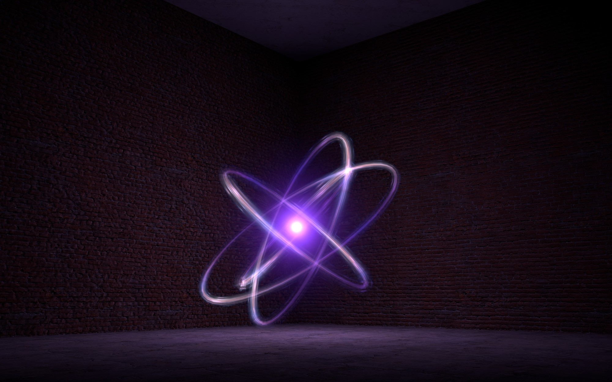

# MapSingularity: Seamless Workshop Roulette

A Garry's Mod addon in pure Lua. While you play, it quietly picks a random Workshop map, downloads and mounts it, warms up its models and materials, and opens a portal. Step in — the view stretches, sound fades, the world goes dark — and you wake up on the new map with your health, armor, weapons and ammo intact.

**Steam Workshop:** https://steamcommunity.com/sharedfiles/filedetails/?id=3842113997

[Українська](#українська) · [Русский](#русский)

## How to play

- Take the **STC "Harrier"** (Spatial Transition Complex) from the spawn menu (MapSingularity).
- **LMB** — open a portal where you aim. **RMB** — roll another map. **R** — collapse the portal.
- The green terminal on the device shows what is happening: searching, downloading, warming up, ready.
- Walk into a stable portal.

Settings: Q menu → Utilities → MapSingularity → Settings (language, where to look for maps, rating filter, portal look, messages, gun position).
Console: `ms_force_fetch [workshop id or link]`, `ms_abort`, `ms_status`, `ms_give_gun`.

## Install

- From the [Workshop](https://steamcommunity.com/sharedfiles/filedetails/?id=3842113997), or
- copy `addon/map_singularity` into `garrysmod/addons/`.

### Loading screen for the host (optional)

Garry's Mod always shows its own loading page to whoever hosts the game, so the portal tunnel is only seen by players who connect to you. To see it yourself, download [MapSingularity_HostLoadingScreen.zip](https://github.com/Prostochell-544/MapSingularity/releases/latest/download/MapSingularity_HostLoadingScreen.zip) from Releases, unpack it and double-click `install.bat`. `uninstall.bat` puts everything back. Details: [docs/HOST-GUIDE.md](docs/HOST-GUIDE.md).

## Repository

| Path | What |
|---|---|
| `addon/map_singularity/` | the addon itself (Lua, model, materials) — a copy of the live folder, synced with `python tools/sync_addon.py` |
| `docs/` | architecture, host guide, model spec |
| `web/` | loading-screen tunnel (canvas, ES5) and the page for `ms_loading_url` |
| `tools/model/` | the STC "Harrier" model: procedural mesh (`kpp_lun_mesh.py`), textures, Blender bake, compile; `python tools/model/build_lun.py` builds everything (needs Blender 5.3 for the bake, `--no-bake` without it) |
| `tools/build_host_installer.py` | builds the host loading-screen installer zip |
| `tools/promo_comic.py`, `tools/model/render_icon.py` | Workshop images |
| `release/` | Workshop icon, screenshots, descriptions (en / uk / ru) |

Build the Workshop package with `gmad.exe create -folder addon/map_singularity -out map_singularity.gma` (from `GarrysMod/bin`).

---

## Українська

Аддон на чистому Lua: поки ви граєте, непомітно обирає випадкову карту з майстерні, завантажує її, прогріває й відкриває портал. Зайдіть у нього — і прокинетеся на новій карті зі збереженим здоров'ям, бронею, зброєю та набоями.

- Візьміть **КПП «Лунь»** у меню спавну (MapSingularity). **ЛКМ** — портал, **ПКМ** — інша карта, **R** — згорнути.
- Налаштування: меню Q → Утиліти → MapSingularity → Налаштування.
- Встановлення: з [майстерні](https://steamcommunity.com/sharedfiles/filedetails/?id=3842113997) або скопіюйте `addon/map_singularity` у `garrysmod/addons/`.
- Екран завантаження для хоста: [MapSingularity_HostLoadingScreen.zip](https://github.com/Prostochell-544/MapSingularity/releases/latest/download/MapSingularity_HostLoadingScreen.zip), розпакуйте й двічі клацніть `install.bat`.

## Русский

Аддон на чистом Lua: пока вы играете, незаметно выбирает случайную карту из мастерской, скачивает её, прогревает и открывает портал. Войдите в него — и проснётесь на новой карте с сохранённым здоровьем, бронёй, оружием и патронами.

- Возьмите **КПП «Лунь»** в меню спавна (MapSingularity). **ЛКМ** — портал, **ПКМ** — другая карта, **R** — схлопнуть.
- Настройки: меню Q → Утилиты → MapSingularity → Настройки.
- Установка: из [мастерской](https://steamcommunity.com/sharedfiles/filedetails/?id=3842113997) или скопируйте `addon/map_singularity` в `garrysmod/addons/`.
- Экран загрузки для хоста: [MapSingularity_HostLoadingScreen.zip](https://github.com/Prostochell-544/MapSingularity/releases/latest/download/MapSingularity_HostLoadingScreen.zip), распакуйте и дважды щёлкните `install.bat`.
